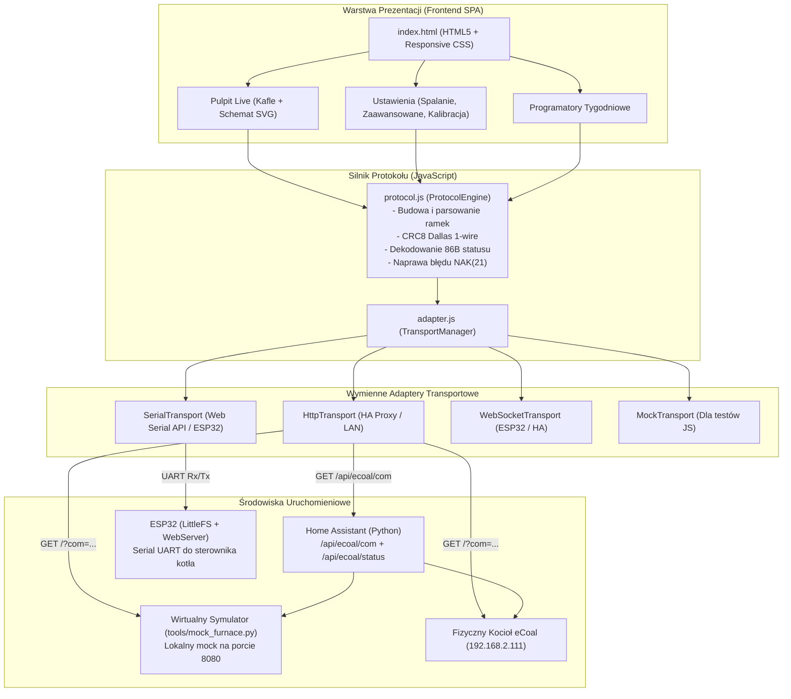

# Plan Wdrożenia: Nowoczesny Interfejs WWW (SPA) i Symulator eCoal

## 1. Cel i Założenia Projektu

1. **Pokrycie 1:1 z oryginalnym sterownikiem eCoal:**
   * Obsługa wszystkich **122 parametrów kotła** (grupy: użytkownika, spalania, zaawansowane, kalibracja, krzywa grzania, sieć).
   * Obsługa **7 programatorów tygodniowych** (CO, CWU, obieg, pokojowy, pogodowy, podłogowy, auto-lato) z podziałem na 48 slotów 30-minutowych.
   * Wykresy temperatur, poziom opału w kg/%, licznik czasu pracy podajnika i historia alarmów.
2. **Bezpieczeństwo (Idzie zima – nie testujemy na żywym kotle):**
   * Stworzenie pełnego wirtualnego symulatora kotła w Pythonie (`tools/mock_furnace.py`), który w pamięci emuluje wszystkie rejestry, czujniki i fizykę kotła oraz odpowiada identycznymi ramkami binarnego protokołu eCoal.
3. **Wymienna warstwa transportowa w JavaScript (Adapter Pattern):**
   * Ten sam kod JavaScript i interfejs UI ma działać wymiennie:
     * **Wariant A (Teraz):** Przez Home Assistant (`/api/ecoal/com`) jako panel boczny.
     * **Wariant B (ESP32):** Bezpośrednio z pamięci LittleFS ESP32 rozmawiając z mikrokontrolerem przez UART Serial lub WebSocket.
     * **Wariant C (Web Serial API):** Bezpośrednio z przeglądarki podłączonej kablem USB-RS232 do komputera.
     * **Wariant D (Mock):** W trybie offline / symulatora dla testów jednostkowych.
4. **Weryfikacja testami automatycznymi (TDD / CI):**
   * Testy jednostkowe protokołu w JS (`node --test tests/frontend/*.test.mjs`).
   * Testy backendu i symulatora w Pythonie (`pytest tests/`).
   * Automatyczny test pokrycia (Coverage 122/122), gwarantujący brak jakichkolwiek braków w UI.

---

## 2. Architektura Systemu

---

## 3. Matryca Pokrycia 1:1 (Inwentarz Parametrów)

Aby zapewnić brak luk względem fabrycznego oprogramowania eCoal:

1. **Pulpit i Szybkie Nastawy (`gr_user` - 9 kontrolek):**
   * Stan kotła, temp. CO, CWU, podajnik, spaliny, powrót, wewnętrzna, zewnętrzna, podłogowa.
   * Stan wyjść: Pompa CO, Pompa CWU, Pompa Mieszacza, Pompa Podłogowa, Pompa Cyrkulacji, Dmuchawa, Podajnik, Zawór 3D.
   * Zapas opału (kg, %, czas pracy ślimaka, przycisk zasypu 100%).
2. **Spalanie i Kocioł (`gr_spalanie` - 33 parametry):**
   * Strojenie spalania grupowego: moce dmuchawy (8, 12, 16, 20, 25, 30 kW) oraz dawki paliwa (8, 12, 16, 20, 25, 30 kW).
   * Zakres mocy kotła: `PARAM_ALG_MINMOC`, `PARAM_ALG_MAXMOC`.
   * Parametry podtrzymania: czas pracy, czas postoju, przerwa, ilość powtórzeń, moc dmuchawy.
   * Parametry grzania: czas pracy, czas postoju, moc dmuchawy grzania, korekta dmuchawy.
   * Regulator temperatury spalin: max temperatura spalin, regulacja nadmuchu.
   * Tryb zasypowy: czasy przedmuchu, odstępy, moc dmuchawy, strefa autoregulacji.
3. **Zaawansowane (`gr_zaaw` - 23 parametry):**
   * Typ podajnika (`PARAM_TYP_PODAJNIKA` = 119: ręczny, grupowe, eCoal, zasypowy).
   * Algorytm automatycznego wygaszania kotła (`PARAM_ALG_WYGASZENIA` = 111).
   * Wyjście pompy mieszającej / ochrona powrotu: tryb, temp. załączenia, aktywacja w lecie.
   * Obwód podłogowy: czasy pracy i postoju pompy podłogowej, współpraca z pompą CO.
   * Czujniki bezpieczeństwa: kontaktron klapy zasobnika, czujnik zerwania zawleczki.
   * Alarm zewnętrzny: czas opóźnienia, inwersja styków, zatrzymanie kotła.
   * Histerezy: histereza kotła CO, histereza bojlera CWU, podbicie temp. CO przy grzaniu CWU.
4. **Kalibracja & Krzywa Grzania (`gr_kalib`, `gr_krzywa` - 10 parametrów):**
   * 8 offsetów czujników (-10.0 .. +10.0 °C).
   * 2 punkty krzywej grzania (M10: -10°C, P10: +10°C).
5. **Harmonogramy Tygodniowe (7 programatorów):**
   * 7 dni tygodnia po 48 slotów 30-minutowych (CO, CWU, Obieg, Pokojowy, Pogodowy, Podłogowy, Auto-Lato).
6. **Statystyki & Historia:**
   * Wykresy temperatur z próbek, histogramy czasu pracy, rejestr alarmów i zdarzeń.

---

## 4. Fazy Implementacji

### Faza 1: Wirtualny Symulator Kotła w Pythonie (`tools/mock_furnace.py`)
* Implementacja serwera HTTP (np. na porcie `8080`) w standardowej bibliotece Pythona.
* Pełna baza 122 parametrów w pamięci z poprawnymi zakresami i wartościami domyślnymi.
* Odpowiedzi w 100% zgodne z protokołem eCoal (ramki STX=2, ADR=1, Status=6/21, CRC8, ETX=3).
* Symulacja falowania temperatur i ubywania węgla w zasobniku podczas pracy podajnika.
* Testy w `tests/test_mock_furnace.py`.

### Faza 2: Silnik Protokołu i Wymienne Adaptery w JavaScript
* `custom_components/ecoal/www/protocol.js`:
  * Tablica CRC8 i funkcja wyliczania sumy kontrolnej.
  * Klasa `CRamka` z poprawną obsługą zarówno statusu 6 (ACK), jak i 21 (NAK) – likwidacja błędu z oryginalnego panelu.
  * Dekoder 86-bajtowej ramki `CMD_STATUS`.
  * Enkodery komend odczytu (`CMD_GET_PARAM`) i zapisu (`CMD_SET_PARAM`).
* `custom_components/ecoal/www/adapter.js`:
  * `HttpTransport` (wysyła `GET /?com=<HEX>` lub `GET /api/ecoal/com?com=<HEX>`).
  * `SerialTransport` (obsługa Web Serial API i strumienia UART).
  * `MockTransport` (wbudowany mock w JS dla natychmiastowych testów).
* Testy w `tests/frontend/protocol.test.mjs` i `tests/frontend/coverage.test.mjs` (`node --test`).

### Faza 3: Integracja z Home Assistant (Proxy & Panel boczny)
* W `custom_components/ecoal/views.py`:
  * `GET /api/ecoal/com?com=<HEX>` – przezroczysty tunel do kotła (lub do mocka).
  * `GET /api/ecoal/status` – szybki zdekodowany JSON ze stanu koordynatora.
  * `POST /api/ecoal/control` – proste sterowanie akcjami (zadana CO, CWU, zasyp).
* W `custom_components/ecoal/__init__.py`:
  * Rejestracja ścieżki statycznej `/ecoal_ui` -> katalog `www/`.
  * Rejestracja panelu bocznego w HA (`frontend.async_register_built_in_panel`) z ikoną `mdi:fire`.
* Testy w `tests/test_views.py`.

### Faza 4: Nowoczesny Dashboard WWW (HTML5/CSS/JS)
* Samowystarczalny plik `custom_components/ecoal/www/index.html`:
  * Responsywny układ na smartfon / tablet / desktop.
  * Wektorowy, animowany schemat hydrauliczny SVG (płynąca woda, obracające się wirniki pomp, pulsujący płomień).
  * Panel szybkiego sterowania temperaturami i zasypem opału.
  * Podstrony z kompletem parametrów spalania, zaawansowanych i harmonogramów.
  * Przełącznik źródła danych w stopce (Auto / Home Assistant / Bezpośredni kocioł / Mock).

### Faza 5: Testy E2E i Przygotowanie pod ESP32
* Uruchomienie mocka i pełne przeklikanie wszystkich zakładek w przeglądarce i w Home Assistant.
* Sprawdzenie testu pokrycia `coverage.test.mjs` (122/122 parametrów).
* Przygotowanie struktury katalogu dla ESP32 (LittleFS).

---

## 5. Jak wznowić pracę w nowym kontekście

W nowym oknie czatu wystarczy podać polecenie:
> **"Wznawiamy projekt zgodnie z planem z pliku docs/modern_ui_plan.md. Zaczynamy od Fazy 1: stworzenia wirtualnego symulatora pieca w tools/mock_furnace.py oraz testów w tests/test_mock_furnace.py."**
